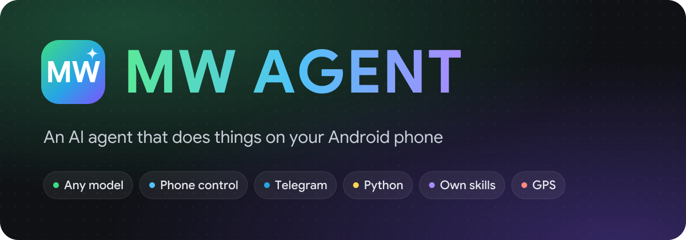

<h1 align="center">
  
</h1>

<p align="center">
  <b>An AI agent that lives on your Android phone and actually does things.</b><br>
  Any model, your own key. It reads the screen, taps through apps, runs Python,<br>
  works with your Telegram account and writes new skills for itself when it lacks one.
</p>

<p align="center">
  <a href="https://github.com/mwdevpy/mwagent/releases/latest"></a>
  <a href="https://github.com/mwdevpy/mwagent/releases"></a>
  <a href="LICENSE"></a>
</p>

<p align="center">
  
  
  
  
  
</p>

<p align="center">
  <a href="https://github.com/mwdevpy/mwagent/releases/latest"><b>Download the APK</b></a> ·
  <a href="#quick-start">Quick start</a> ·
  <a href="#tools">Tools</a> ·
  <a href="#privacy-and-safety">Privacy</a> ·
  <a href="#по-русски">По-русски</a>
</p>

<p align="center">
  
</p>

<p align="center">
  
  
  
</p>
<p align="center">
  
  
  
</p>

## Why MW AGENT

<table>
  <tr>
    <td width="33%" valign="top">
      <h3>🧠 Any model</h3>
      OpenAI-compatible, Anthropic and Gemini APIs natively. OpenRouter, Ollama, LM Studio or your own server. Bring your own key, the app talks to the provider directly.
    </td>
    <td width="33%" valign="top">
      <h3>📱 Runs your phone</h3>
      Reads the screen, taps, types, scrolls and opens apps through an accessibility service. Python scripts can drive long flows with loops and conditions.
    </td>
    <td width="33%" valign="top">
      <h3>✈️ Your Telegram</h3>
      Link your own account through the user API. The agent reads chats, searches messages, sends text and files, and writes Telethon scripts for anything else.
    </td>
  </tr>
  <tr>
    <td valign="top">
      <h3>🛠️ Grows new skills</h3>
      When no tool fits, it writes the missing logic in Python, saves it as a skill, runs it and fixes it on errors. Saved skills come back in every chat.
    </td>
    <td valign="top">
      <h3>📍 Knows the context</h3>
      Location with a street address, battery, network, storage and volume, the clipboard and the screen you opened it over. You choose what it may see.
    </td>
    <td valign="top">
      <h3>🔒 Yours only</h3>
      No backend, no account, no analytics. Keys and the Telegram session are encrypted with the Android Keystore. Every tool is Off, Ask or Auto.
    </td>
  </tr>
</table>

## Try saying

> **"How's my phone doing?"** battery, temperature, network, free space in one answer
>
> **"Find the messages about the invoice in my Telegram and send the PDF from Downloads to Anna"** search, then a file with a caption, after you approve
>
> **"Where am I, and build a walking route to the nearest pharmacy"** GPS, web search, maps
>
> **"Make a QR code for my Wi-Fi so guests can join"** a scannable picture right in the chat
>
> **"Put a dentist appointment on Friday at 15:30 in my calendar"** a filled-in event, you tap save
>
> **"Every morning I want a summary of my unread Telegram chats"** it writes a skill once and reuses it

## Features

<details open>
<summary><b>Models and providers</b></summary>

- Three native formats: OpenAI-compatible (anything that serves `/chat/completions`), Anthropic Messages and Google Gemini.
- Custom base URL and extra headers per provider.
- Live model list with search and filters for vision, reasoning and image output. The last picked model is used for new chats.
- Streaming everywhere, including tool calls and token usage.
- Reasoning effort per chat, with the thinking shown in a collapsible block. Anthropic thinking signatures, Gemini thought signatures and OpenAI `reasoning_details` are kept across tool calls.
- Prompt caching for Claude and image output for models that can draw.

</details>

<details open>
<summary><b>Telegram</b></summary>

- Sign in with your own account: API ID and hash from [my.telegram.org](https://my.telegram.org), phone, login code and the two-step password if you have one.
- Built-in tools for your profile, chat list, messages, search across all chats, and sending text or files, also as a reply to a message.
- Chats are found by @username, phone, id, `me` for Saved Messages, or simply by their name in your chat list.
- Python scripts get `import tg`: `me()`, `dialogs()`, `messages()`, `search()`, `send()`, `send_file()`, and `raw()` with `run()` for the full [Telethon](https://docs.telethon.dev) client.
- The session is stored encrypted on the phone and never leaves it except to Telegram. Sending and reading ask first by default.

</details>

<details open>
<summary><b>Skills: the agent extends itself</b></summary>

- When nothing built-in does what you ask, the agent writes a Python skill, saves it in `workspace/skills/` and runs it with JSON parameters.
- If it fails, the agent reads the traceback, fixes the code and saves it again.
- Saved skills are listed for the model in every chat, so it reuses them instead of starting over.
- Skills can use the standard library, Telegram through `import tg`, and the `phone` module when phone control from Python is on.
- Saving and running ask first. Skills follow the `run_python` switch: turn Python off and skills are off too.

</details>

<details>
<summary><b>Phone and device</b></summary>

- Phone control through an accessibility service: the screen as numbered elements, screenshots, taps, typing, swipes, system keys and opening apps. It refuses to act on MW AGENT's own screen.
- Python 3.13 on the phone (Chaquopy) with a `phone` module for long automated flows and saved routines.
- Shell in a sandbox (default), Termux, Shizuku or root.
- Device status, flashlight, volume, clipboard and QR codes.
- Calendar events, the dialer, SMS and email drafts and map routes open in your own apps, and you finish the action there.
- Location from GPS or the network with the nearest street address.
- File access limited to the app folder by default, or phone storage with All files access, or root.

</details>

<details>
<summary><b>Chats and agents</b></summary>

- Folders, archive, a trash that empties after 30 days, configurable swipe actions and multi-select.
- Search across titles and messages with highlighted snippets that jump to the message.
- Every chat gets a title, icon, color and shape after the first reply.
- Replies keep streaming in the background, with a Stop button in the notification.
- Markdown with highlighted code, LaTeX, charts and flow diagrams in the chat, quick-reply chips and source pills.
- As many agents as you like, each with a system prompt, an animated avatar, its own tool permissions and voice. Prompts accept `{agent_name}`, `{date}`, `{time}`, `{weekday}`, `{timezone}`, `{device}`, `{android}`, `{battery}` and `{locale}`.

<p align="center">
  
  
  
  
</p>

</details>

<details>
<summary><b>Memory, voice and assistant</b></summary>

- Two-tier memory: instant memories always in the prompt, long-term ones searched by keyword or by embeddings (Gemini or any OpenAI-compatible `/embeddings`).
- Dictation through OpenAI-format, Gemini or ElevenLabs transcription. Replies read aloud with the system voice or a provider voice.
- Set MW AGENT as the default digital assistant to open it over any app with a gesture. It can read the app underneath.

</details>

<details>
<summary><b>MCP</b></summary>

- Remote [MCP](https://modelcontextprotocol.io) servers over Streamable HTTP, with a bearer token or OAuth (discovery, dynamic client registration, PKCE).
- Server tools appear as `mcp_<server>_<tool>`, server instructions go into the prompt, and elicitation requests show up as forms in the chat.

</details>

<details>
<summary><b>Look and feel</b></summary>

- Material 3 Expressive, dynamic color on Android 12+, dark theme, Google Sans, haptics and predictive back.
- English and Russian.
- Optional DNS over HTTPS for all traffic.

</details>

## Tools

50 built-in tools plus any number of MCP servers. Each one is **Off**, **Ask** or **Auto**, globally in Settings and per agent. An Ask tool pauses the reply and shows a card with the arguments: Allow, Deny, or Always allow in this session.

<details>
<summary><b>See all 50 tools</b></summary>

**Web and world**

| Tool | What it does | Default |
|---|---|---|
| `web_search` | DuckDuckGo (default), SearXNG or Brave | Auto |
| `read_webpage` | A page as clean text through Jina Reader, directly or your own reader | Auto |
| `get_weather` | Current weather and a 1 to 7 day forecast from Open-Meteo | Auto |
| `get_location` | GPS or network position with the nearest address | Ask |

**Telegram**

| Tool | What it does | Default |
|---|---|---|
| `telegram_me` | Your account: name, username, phone, Premium, bio | Auto |
| `telegram_chats` | Chat list with unread counts | Ask |
| `telegram_messages` | Recent messages of a chat, with media and replies marked | Ask |
| `telegram_search` | Find messages by text in one chat or all of them | Ask |
| `telegram_send` | Send text or a file, optionally as a reply | Ask |

**Phone control**

| Tool | What it does | Default |
|---|---|---|
| `read_screen` | Text of the app the assistant was opened over | Auto |
| `phone_screen` | The live screen as numbered elements | Auto |
| `phone_screenshot` | A screenshot the model can look at | Auto |
| `phone_action` | Tap, type, scroll, swipe, keys, open apps | Ask |

**Device**

| Tool | What it does | Default |
|---|---|---|
| `device_status` | Battery, charging, network, storage, RAM, volume, brightness | Auto |
| `flashlight` | Flashlight on or off | Auto |
| `set_volume` | Media, ring, notification, alarm or call volume | Ask |
| `copy_to_clipboard` | Put text on the clipboard | Auto |
| `read_clipboard` | Read the copied text | Ask |
| `make_qr_code` | QR code for a link, Wi-Fi, contact or text | Auto |

**Other apps** (open filled in, you finish there)

| Tool | What it does | Default |
|---|---|---|
| `add_calendar_event` | A new event in your calendar | Ask |
| `dial_number` | The dialer with the number | Ask |
| `compose_message` | A ready SMS or email | Ask |
| `navigate_to` | A route in your maps app | Auto |

**Code and skills**

| Tool | What it does | Default |
|---|---|---|
| `run_command` | Shell in the sandbox, Termux, Shizuku or root | Ask |
| `run_python` | Python 3.13 with Telethon and the phone module | Ask |
| `skill_save` | Save or fix a skill the agent wrote | Ask |
| `skill_run` | Run a saved skill with JSON params | Ask |
| `skill_list` | List skills or show the source of one | Auto |
| `skill_delete` | Delete a skill | Ask |

**Files**

| Tool | What it does | Default |
|---|---|---|
| `list_files`, `read_file` | Browse and read files in the allowed scope | Auto |
| `write_file` | Write or append text | Ask |
| `send_files` | Show files and images in the chat | Auto |

**Time**

| Tool | What it does | Default |
|---|---|---|
| `set_reminder`, `list_reminders`, `cancel_reminder` | Reminders that notify you and open the chat | Auto |
| `set_alarm`, `set_timer` | Alarm or timer in the clock app | Auto |

**Memory and chats**

| Tool | What it does | Default |
|---|---|---|
| `memory_save`, `memory_update`, `memory_delete`, `memory_search` | Manage and search memories | Auto |
| `list_chats`, `read_chat`, `search_messages` | Look through your other chats | Auto |
| `export_chat` | Save a chat as Markdown | Ask |

**In the chat**

| Tool | What it does | Default |
|---|---|---|
| `show_ui` | Quick-reply chips and buttons | Auto |
| `show_chart` | Line, bar or pie chart | Auto |
| `show_diagram` | Flow diagram | Auto |
| `ask_user` | A multiple-choice question that waits for you | Auto |

Tools from MCP servers always start as Ask.

</details>

## Quick start

1. Download `mw-agent-<version>.apk` from the [latest release](https://github.com/mwdevpy/mwagent/releases/latest). Android 10 or newer, 64-bit ARM (arm64-v8a).
2. Open the file and allow installs from that app when Android asks.
3. **Settings → Models**: add a provider, pick the API format, paste the base URL (prefilled for OpenAI, Anthropic and Gemini) and your key.
4. Pick a model at the top of a new chat and say hi.
5. Optional: **Settings → Telegram** to link your account, **Device access** for location, phone control and files.

The app never updates itself. **About → Check for updates** asks GitHub only when you tap it.

<details>
<summary><b>Verify the APK</b></summary>

Run `apksigner verify --print-certs mw-agent-<version>.apk` and compare the SHA-256 digest of the signer certificate:

```
7ddf784ffa7ed58dc259fd7a2b9065d7e67a5f93db21bfe6015351d5459e8bea
```

</details>

## Troubleshooting

<details>
<summary><b>Play Protect says "App blocked to protect your device"</b></summary>

Play Protect blocks sideloaded apps that declare an accessibility service, because such permissions are often abused. MW AGENT declares one for phone control, so it matches the rule. The service does nothing until you switch it on, and the block is a blanket rule, not a finding about this app. The code is all here and the release can be checked against the fingerprint above.

To install anyway: Google Play → profile picture → Play Protect → gear → switch off **Scan apps with Play Protect**, then open the APK again. Whether to turn scanning back on afterwards is your call. If you only pause it, Play Protect may remove the app when it resumes.

</details>

<details>
<summary><b>The accessibility switch is greyed out</b></summary>

Android restricts accessibility for apps installed outside a store. Open App info for MW AGENT, tap ⋮, choose **Allow restricted settings**, then switch the service on.

</details>

<details>
<summary><b>Telegram tools say no account is linked</b></summary>

Link it in **Settings → Telegram** with an API ID and hash from my.telegram.org. If Telegram ended the session (for example from another device), link it again.

</details>

<details>
<summary><b>Calendar, dialer, SMS or maps did not open</b></summary>

Android only lets an app open other apps while it is on screen. Keep MW AGENT open while the agent does it.

</details>

## Privacy and safety

- **Nothing goes to us.** No analytics, no crash reports, no accounts, cloud backup off.
- **Local and encrypted.** Chats sit in a local database. Provider keys, tool settings and the Telegram session are encrypted with an Android Keystore key.
- **Direct traffic only.** Your messages go to the provider you set up, Telegram traffic only to Telegram. Defaults that touch public services, each replaceable in Settings: DuckDuckGo (`web_search`), r.jina.ai (`read_webpage`), Open-Meteo (`get_weather`). Source pills load favicons from the sites themselves. The update check calls `api.github.com` when you tap it.
- **You approve the risky parts.** Sending, reading private data, running code and changing settings ask first by default. Calls, SMS, emails and calendar events are only prepared, you finish them yourself.
- **Permissions:** internet and network state, vibration, microphone (dictation), notifications, exact alarms and boot (reminders), location (only after you grant it in Device access) and a foreground service (background streaming). Termux, All files access and the accessibility service are optional and off until you enable them. No camera or contacts permission. Location is read only when a reply calls `get_location`; address lookup uses the system geocoder, which on some phones contacts the phone maker's service.

## Build

```bash
git clone https://github.com/mwdevpy/mwagent.git
cd mwagent
./gradlew assembleDebug
./gradlew testDebugUnitTest
```

- JDK 17 and the Android SDK with platform 37 (`sdk.dir` in `local.properties`, or `ANDROID_HOME`). The wrapper downloads Gradle 9.8.
- Python 3.13 on the path is optional; Chaquopy uses it to precompile bytecode.
- The debug APK lands in `app/build/outputs/apk/debug/`. Unit tests run on the JVM, no device needed.
- `assembleRelease` needs your own key: create `keystore/keystore.properties` (git-ignored) with `storeFile`, `storePassword`, `keyAlias` and `keyPassword`.

Built with Kotlin, Jetpack Compose, Room, DataStore, OkHttp, Coil, Chaquopy, Telethon, ZXing, Shizuku and dyn4j.

## Contributing

Issues and pull requests are welcome. For anything bigger than a small fix, open an issue first so we agree on the direction, and run `./gradlew testDebugUnitTest` before sending a change.

## По-русски

**MW AGENT** — ИИ-агент для Android, который не просто отвечает, а делает: читает экран и нажимает кнопки в приложениях, запускает Python, работает с твоим аккаунтом Telegram, знает, где ты, следит за состоянием телефона и сам пишет себе новые навыки, когда готового инструмента нет.

- Любая модель через свой ключ: OpenAI-совместимые, Anthropic, Gemini, OpenRouter, Ollama, LM Studio.
- Telegram через user API: чаты, поиск, отправка сообщений и файлов, скрипты на Telethon.
- Навыки: агент пишет недостающую логику на Python, сохраняет и исправляет её сам.
- Фонарик, громкость, буфер обмена, QR-коды, события в календаре, звонилка, SMS, письма и маршруты.
- Без сервера, аккаунта и аналитики. Ключи и сессия Telegram зашифрованы, опасные действия спрашивают разрешение.

Скачать: [последний релиз](https://github.com/mwdevpy/mwagent/releases/latest). Интерфейс на русском и английском.

## License

GNU General Public License v3.0, see [LICENSE](LICENSE).

MW AGENT is a fork of [MD3 Agent](https://github.com/huecoder/MD3-Agent) by huecoder, modified and distributed under the same GPL v3 terms. The original project is not affiliated with this fork and is not responsible for it.

Third-party libraries and assets are listed in [THIRD_PARTY.md](THIRD_PARTY.md). Vendor trademarks belong to their owners.
