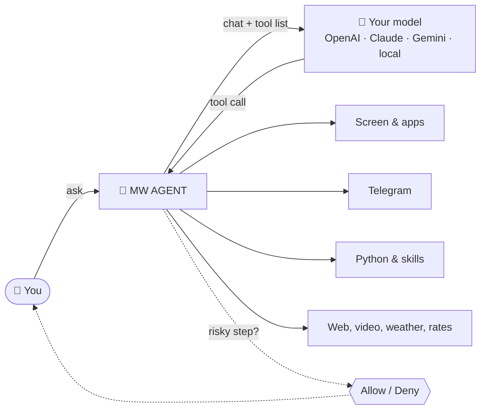

<p align="center">
  
</p>

<h3 align="center">MW AGENT: an AI agent that lives on your phone and actually does things</h3>

<p align="center">
  Any model, your own key. It reads the screen, taps through apps, runs Python,<br>
  downloads videos, works with your Telegram and writes new skills for itself.
</p>

<p align="center">
  <a href="https://github.com/mwdevpy/mwagent/releases/latest">
    
  </a>
</p>

<p align="center">
  <a href="https://github.com/mwdevpy/mwagent/releases/latest"></a>
  <a href="https://github.com/mwdevpy/mwagent/releases"></a>
  <a href="LICENSE"></a>
  
  
  
</p>

<p align="center">
  <a href="#-what-it-can-do">Features</a> ·
  <a href="#-try-saying">Examples</a> ·
  <a href="#-tools">Tools</a> ·
  <a href="#-quick-start">Install</a> ·
  <a href="#-privacy-and-safety">Privacy</a> ·
  <a href="#-по-русски">По-русски</a>
</p>

<br>

<p align="center">
  
  &nbsp;
  
  &nbsp;
  
</p>

<br>

## ✨ What it can do

<table>
  <tr>
    <td width="33%" valign="top">
      <h4>🧠 Any model</h4>
      OpenAI-compatible, Anthropic and Gemini natively. OpenRouter, Ollama, LM Studio or your own server, with your own key.
    </td>
    <td width="33%" valign="top">
      <h4>📱 Runs your phone</h4>
      Reads the screen, taps, types, scrolls and opens apps. Python scripts drive long flows with loops and conditions.
    </td>
    <td width="33%" valign="top">
      <h4>✈️ Your Telegram</h4>
      Your own account through the user API: read chats, search, send text and files, or script anything with Telethon.
    </td>
  </tr>
  <tr>
    <td valign="top">
      <h4>🎬 Downloads videos</h4>
      YouTube, TikTok, Instagram, X, VK and many more by link. Video or just the sound, straight to Downloads.
    </td>
    <td valign="top">
      <h4>🛠️ Grows new skills</h4>
      No tool for it? It writes the logic in Python, saves it as a skill, fixes it on errors and reuses it later.
    </td>
    <td valign="top">
      <h4>📍 Knows the context</h4>
      Location with an address, battery, network, storage, the clipboard and the app you opened it over.
    </td>
  </tr>
  <tr>
    <td valign="top">
      <h4>🗓️ Works with your apps</h4>
      Calendar events, calls, SMS, email, map routes and the share sheet, filled in for you to confirm.
    </td>
    <td valign="top">
      <h4>🧩 MCP and memory</h4>
      Connect remote MCP servers. Two-tier memory keeps what matters about you across chats.
    </td>
    <td valign="top">
      <h4>🔒 Yours only</h4>
      No backend, no account, no analytics. Keys are encrypted. Every tool is Off, Ask or Auto.
    </td>
  </tr>
</table>

## 🔄 How it works



The app is only a client. It sends your message to the model you chose, the model picks tools, and the app runs them on the phone. Anything risky waits for your tap.

## 💬 Try saying

| You say | What happens |
|---|---|
| *"How's my phone doing?"* | Battery, temperature, network and free space in one answer |
| *"Download this TikTok and the sound from this YouTube video"* | Both files in the chat and in Downloads/MW AGENT |
| *"Find the invoice messages in my Telegram and send the PDF to Anna"* | A search, then a file with a caption, after you approve |
| *"Where am I? Walking route to the nearest pharmacy"* | GPS, a web search, then maps open with the route |
| *"How much is 250 euros in rubles?"* | Today's rate and the amount |
| *"QR code for my Wi-Fi so guests can join"* | A scannable picture right in the chat |
| *"Dentist on Friday at 15:30, put it in my calendar"* | A filled-in event, you tap save |
| *"Count my unread Telegram chats by folder"* | It writes a skill once and reuses it next time |

## 📚 Features in detail

<details>
<summary><b>🧠 Models and providers</b></summary>
<br>

- Three native formats: OpenAI-compatible (anything with `/chat/completions`), Anthropic Messages and Google Gemini.
- Custom base URL and extra headers per provider.
- Live model list with search and filters for vision, reasoning and image output. New chats start with the last model you picked.
- Streaming everywhere, including tool calls and token usage.
- Reasoning effort per chat with the thinking in a collapsible block. Anthropic thinking signatures, Gemini thought signatures and OpenAI `reasoning_details` are kept across tool calls.
- Prompt caching for Claude and image output for models that can draw.

</details>

<details>
<summary><b>✈️ Telegram</b></summary>
<br>

- Sign in with your own account: API ID and hash from [my.telegram.org](https://my.telegram.org), phone, login code and the two-step password if you have one.
- Built-in tools for your profile, chat list, messages, search across all chats and sending text or files, also as a reply.
- Chats are found by @username, phone, id, `me` for Saved Messages, or simply by their name.
- Scripts get `import tg`: `me()`, `dialogs()`, `messages()`, `search()`, `send()`, `send_file()`, and `raw()` with `run()` for the full [Telethon](https://docs.telethon.dev) client.
- The session is encrypted on the phone and only ever talks to Telegram.

</details>

<details>
<summary><b>🎬 Video downloads</b></summary>
<br>

- **YouTube** videos and Shorts up to 1080p. Video and sound arrive separately and are joined on the phone with Android's own muxer, no ffmpeg needed.
- **TikTok** videos, photo posts and sounds.
- **Everything else yt-dlp supports**: Instagram, X, VK, Reddit, Twitch clips, SoundCloud and more than a thousand other sites.
- Sound only on request. Files are shown in the chat and saved to Downloads/MW AGENT.

</details>

<details>
<summary><b>🛠️ Skills: the agent extends itself</b></summary>
<br>

- When nothing built-in fits, the agent writes a Python skill, saves it in `workspace/skills/` and runs it with JSON parameters.
- If it fails, the agent reads the traceback, fixes the code and saves it again.
- Saved skills are listed for the model in every chat, so it reuses them.
- Skills can use the standard library, Telegram through `import tg`, and the `phone` module when phone control from Python is on.
- Saving and running ask first, and skills follow the `run_python` switch.

</details>

<details>
<summary><b>📱 Phone and device</b></summary>
<br>

- Phone control through an accessibility service: the screen as numbered elements, screenshots, taps, typing, swipes, system keys and opening apps. It never acts on MW AGENT's own screen.
- Python 3.13 on the phone (Chaquopy) with a `phone` module for long flows and saved routines.
- Shell in a sandbox (default), Termux, Shizuku or root.
- Device status, flashlight, volume, clipboard, QR codes and exchange rates.
- Calendar, dialer, SMS, email, maps and the share sheet open filled in, and you finish there.
- Location from GPS or the network with the nearest address.
- Files limited to the app folder by default, or phone storage with All files access, or root.

</details>

<details>
<summary><b>💬 Chats and agents</b></summary>
<br>

- Folders, archive, a 30-day trash, swipe actions and multi-select.
- Search across titles and messages with highlighted snippets.
- Each chat gets a title, icon, color and shape after the first reply.
- Replies keep streaming in the background with a Stop button in the notification.
- Markdown with highlighted code, LaTeX, charts and diagrams, quick-reply chips and source pills.
- As many agents as you like, each with its own prompt, animated avatar, tool permissions and voice. Prompts accept `{agent_name}`, `{date}`, `{time}`, `{weekday}`, `{timezone}`, `{device}`, `{android}`, `{battery}` and `{locale}`.

<p align="center">
  
  
  
  
</p>

</details>

<details>
<summary><b>🧩 Memory, voice, assistant and MCP</b></summary>
<br>

- Two-tier memory: instant memories always in the prompt, long-term ones searched by keyword or embeddings.
- Dictation through OpenAI-format, Gemini or ElevenLabs transcription. Replies read aloud with the system voice or a provider voice.
- Set MW AGENT as the default assistant to open it over any app with a gesture. It can read the app underneath.
- Remote [MCP](https://modelcontextprotocol.io) servers over Streamable HTTP with a token or OAuth. Server tools appear as `mcp_<server>_<tool>`.
- Material 3 Expressive, dynamic color, dark theme, English and Russian, optional DNS over HTTPS.

</details>

## 🧰 Tools

**55 built-in tools** plus any MCP server. Each one is **Off**, **Ask** or **Auto**, globally and per agent. An Ask tool pauses the reply with a card: Allow, Deny, or Always allow in this session.

<details>
<summary><b>Show all 55 tools</b></summary>
<br>

#### 🌐 Web and world
| Tool | What it does | Default |
|---|---|---|
| `web_search` | DuckDuckGo (default), SearXNG or Brave | Auto |
| `read_webpage` | A page as clean text | Auto |
| `get_weather` | Weather and a 1 to 7 day forecast from Open-Meteo | Auto |
| `get_location` | GPS or network position with the nearest address | Ask |
| `currency_rates` | Rates for 160 currencies and conversion | Auto |
| `download_media` | Video, sound or photos by link | Auto |

#### ✈️ Telegram
| Tool | What it does | Default |
|---|---|---|
| `telegram_me` | Your account: name, username, phone, Premium, bio | Auto |
| `telegram_chats` | Chat list with unread counts | Ask |
| `telegram_messages` | Recent messages of a chat | Ask |
| `telegram_search` | Find messages in one chat or all of them | Ask |
| `telegram_send` | Send text or a file, optionally as a reply | Ask |

#### 📱 Phone control
| Tool | What it does | Default |
|---|---|---|
| `read_screen` | Text of the app the assistant was opened over | Auto |
| `phone_screen` | The live screen as numbered elements | Auto |
| `phone_screenshot` | A screenshot the model can look at | Auto |
| `phone_action` | Tap, type, scroll, swipe, keys, open apps | Ask |

#### 🔦 Device
| Tool | What it does | Default |
|---|---|---|
| `device_status` | Battery, network, storage, RAM, volume, brightness | Auto |
| `flashlight` | Flashlight on or off | Auto |
| `set_volume` | Media, ring, notification, alarm or call volume | Ask |
| `copy_to_clipboard` | Put text on the clipboard | Auto |
| `read_clipboard` | Read the copied text | Ask |
| `make_qr_code` | QR code for a link, Wi-Fi, contact or text | Auto |

#### 🗓️ Other apps
| Tool | What it does | Default |
|---|---|---|
| `add_calendar_event` | A new event in your calendar | Ask |
| `dial_number` | The dialer with the number | Ask |
| `compose_message` | A ready SMS or email | Ask |
| `navigate_to` | A route in your maps app | Auto |
| `open_link` | A link in the browser or its app | Auto |
| `share` | The share sheet with text or files | Ask |

#### 🛠️ Code and skills
| Tool | What it does | Default |
|---|---|---|
| `run_command` | Shell in the sandbox, Termux, Shizuku or root | Ask |
| `run_python` | Python 3.13 with Telethon and the phone module | Ask |
| `skill_save` | Save or fix a skill the agent wrote | Ask |
| `skill_run` | Run a saved skill | Ask |
| `skill_list` | List skills or show the source of one | Auto |
| `skill_delete` | Delete a skill | Ask |

#### 📁 Files
| Tool | What it does | Default |
|---|---|---|
| `list_files`, `read_file` | Browse and read files in the allowed scope | Auto |
| `write_file` | Write or append text | Ask |
| `send_files` | Show files and images in the chat | Auto |
| `save_to_downloads` | Put a file in Downloads/MW AGENT | Auto |

#### ⏰ Time
| Tool | What it does | Default |
|---|---|---|
| `set_reminder`, `list_reminders`, `cancel_reminder` | Reminders that notify you and open the chat | Auto |
| `set_alarm`, `set_timer` | Alarm or timer in the clock app | Auto |

#### 🧠 Memory and chats
| Tool | What it does | Default |
|---|---|---|
| `memory_save`, `memory_update`, `memory_delete`, `memory_search` | Manage and search memories | Auto |
| `list_chats`, `read_chat`, `search_messages` | Look through your other chats | Auto |
| `export_chat` | Save a chat as Markdown | Ask |

#### 🎨 In the chat
| Tool | What it does | Default |
|---|---|---|
| `show_ui` | Quick-reply chips and buttons | Auto |
| `show_chart` | Line, bar or pie chart | Auto |
| `show_diagram` | Flow diagram | Auto |
| `ask_user` | A multiple-choice question that waits for you | Auto |

Tools from MCP servers always start as Ask.

</details>

## 🚀 Quick start

| Step | |
|:-:|---|
| **1** | Download `mw-agent-<version>.apk` from the [latest release](https://github.com/mwdevpy/mwagent/releases/latest). Android 10+, 64-bit ARM. |
| **2** | Open the file and allow installs from that app when Android asks. |
| **3** | **Settings → Models**: add a provider, pick the API format, paste the base URL and your key. |
| **4** | Pick a model at the top of a new chat and say hi. |
| **5** | Optional: **Settings → Telegram** to link your account, **Device access** for location, phone control and files. |

The app never updates itself. **About → Check for updates** asks GitHub only when you tap it.

<details>
<summary><b>🔏 Verify the APK</b></summary>
<br>

Run `apksigner verify --print-certs mw-agent-<version>.apk` and compare the SHA-256 digest of the signer certificate:

```
7ddf784ffa7ed58dc259fd7a2b9065d7e67a5f93db21bfe6015351d5459e8bea
```

</details>

## 🩺 Troubleshooting

<details>
<summary><b>Play Protect says "App blocked to protect your device"</b></summary>
<br>

Play Protect blocks sideloaded apps that declare an accessibility service, because such permissions are often abused. MW AGENT declares one for phone control. The service does nothing until you switch it on, and the block is a blanket rule, not a finding about this app. The code is all here and the release can be checked against the fingerprint above.

To install anyway: Google Play → profile picture → Play Protect → gear → switch off **Scan apps with Play Protect**, then open the APK again. Whether to turn scanning back on is your call; if you only pause it, Play Protect may remove the app when it resumes.

</details>

<details>
<summary><b>The accessibility switch is greyed out</b></summary>
<br>

Android restricts accessibility for apps installed outside a store. Open App info for MW AGENT, tap ⋮, choose **Allow restricted settings**, then switch the service on.

</details>

<details>
<summary><b>Telegram tools say no account is linked</b></summary>
<br>

Link it in **Settings → Telegram** with an API ID and hash from my.telegram.org. If Telegram ended the session, for example from another device, link it again.

</details>

<details>
<summary><b>Calendar, dialer, SMS, maps or sharing did not open</b></summary>
<br>

Android only lets an app open other apps while it is on screen. Keep MW AGENT open while the agent does it.

</details>

<details>
<summary><b>A video did not download</b></summary>
<br>

The video may be private, age-restricted, region-locked or larger than the limit. Sites also change often; a newer MW AGENT release usually brings an updated downloader.

</details>

## 🔐 Privacy and safety

|  |  |
|---|---|
| 🚫 **Nothing goes to us** | No analytics, no crash reports, no accounts, cloud backup off. |
| 🗝️ **Local and encrypted** | Chats sit in a local database. Provider keys, tool settings and the Telegram session are encrypted with an Android Keystore key. |
| ➡️ **Direct traffic only** | Messages go to the provider you set up, Telegram traffic only to Telegram, downloads only to the site of the link. Defaults that use public services, each replaceable in Settings: DuckDuckGo, r.jina.ai and Open-Meteo. Exchange rates come from open.er-api.com. The update check calls GitHub when you tap it. |
| ✋ **You approve the risky parts** | Sending, reading private data, running code and changing settings ask first by default. Calls, SMS, emails and calendar events are only prepared; you finish them yourself. |
| 📋 **Permissions** | Internet and network state, vibration, microphone (dictation), notifications, exact alarms and boot (reminders), location (only after you grant it) and a foreground service (background replies). Termux, All files access and the accessibility service stay off until you enable them. No camera or contacts permission. |

## 🇷🇺 По-русски

**MW AGENT** — ИИ-агент для Android, который не просто отвечает, а делает: читает экран и нажимает кнопки в приложениях, запускает Python, качает видео, работает с твоим Telegram и сам пишет себе новые навыки, когда готового инструмента нет.

- 🧠 Любая модель через свой ключ: OpenAI-совместимые, Claude, Gemini, OpenRouter, Ollama, LM Studio.
- ✈️ Telegram через user API: чаты, поиск, отправка сообщений и файлов, скрипты на Telethon.
- 🎬 Видео и звук по ссылке: YouTube, TikTok, Instagram, X, VK и другие, сразу в Загрузки.
- 🛠️ Навыки: агент сам пишет, сохраняет и чинит недостающую логику на Python.
- 🔦 Курсы валют, фонарик, громкость, буфер обмена, QR-коды, календарь, звонки, SMS, письма, маршруты и «Поделиться».
- 🔒 Без сервера, аккаунта и аналитики. Ключи и сессия Telegram зашифрованы, опасные действия спрашивают разрешение.

<p align="center">
  <a href="https://github.com/mwdevpy/mwagent/releases/latest">
    
  </a>
</p>

## 📄 License

GNU General Public License v3.0, see [LICENSE](LICENSE).

MW AGENT is a fork of [MD3 Agent](https://github.com/huecoder/MD3-Agent) by huecoder, modified and distributed under the same GPL v3 terms. The original project is not affiliated with this fork and is not responsible for it. Third-party libraries and assets are listed in [THIRD_PARTY.md](THIRD_PARTY.md).
